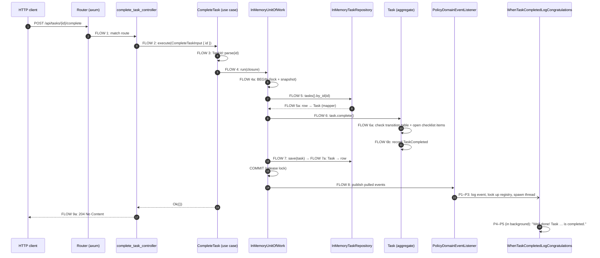

# Code flow: what happens during one request, and why

This walkthrough follows **one request** from the network to the database and back:

```
POST /api/tasks/{id}/complete
```

Every step has a matching `FLOW n` comment in the code. Search for it to jump there:

```bash
grep -rn "FLOW" src
```

## The big picture



If something goes wrong, the flow stops early and returns an error instead.
[What happens when it fails](#what-happens-when-it-fails) shows how.

## Step by step

### FLOW 0: start-up — `src/main.rs`, `src/main_modules/mod.rs`
**What:** `bootstrap()` creates the store, the Unit of Work, the queries and all use cases, and
puts them in an `AppState`.
**Why:** this is the **composition root**, the *only* place that names concrete types like
`InMemoryUnitOfWork`. Use cases only know the `UnitOfWork` *trait*. To move to Postgres you
change this one function and nothing else.

### FLOW 1: routing — `src/infrastructure/web_api/web_api_routes.rs`
**What:** axum looks up `POST /api/tasks/{id}/complete` in the route table and calls
`complete_task_controller`.
**Why:** one table lists the whole HTTP surface, so you can see every endpoint at a glance.

### FLOW 2: controller — `src/infrastructure/web_api/controllers/complete_task_controller.rs`
**What:** it takes the `id` out of the URL, builds a `CompleteTaskInput` (the request "please
complete this task"), and hands it to its handler, the `CompleteTask` use case.
**Why so thin:** the controller holds **no business rules**. It only translates HTTP into Rust
and back. The same use case can then be called from a test, a CLI or a queue consumer.

### FLOW 3: validate the input — `src/application/tasks/commands/complete_task.rs`
**What:** `TaskId::parse` turns the string into a `TaskId`, or fails with `InvalidTaskId`.
**Why:** validating at the edge means everything deeper works with types that are always
valid. You never write "is this string a UUID?" twice.

### FLOW 4: open a transaction — `InMemoryUnitOfWork::run`
**What:** the use case passes a closure to `unit_of_work.run(...)`. `run` takes a lock and a
snapshot (BEGIN), calls the closure, and then either commits or restores the snapshot (ROLLBACK).
**Why a closure:** the Unit of Work wraps your code, so it controls begin, commit and rollback.
A use case *cannot* forget to commit or to roll back.

### FLOW 5: load the aggregate — `InMemoryTaskRepository::by_id`
**What:** it reads the row, and the mapper (`reconstitute`) turns those strings back into a
`Task`. `Task::reconstitute` raises **no** event, because loading is not news.
**Why a repository:** the use case asks for "the task with this ID" without knowing about
HashMaps or SQL. **Why re-validate the row:** a corrupt row becomes an `Infrastructure` error
instead of crashing the server.

### FLOW 6: the business rule — `Task::complete` in `src/domain/.../task.rs`
**What:**
1. **6a:** `TaskStatus::transition_to(Done)` checks the transition table. `Done → Done` is not
   allowed, so `?` returns the error right away. Next, the task counts its **unchecked
   checklist items** (inner entities). If any are open, it refuses with
   `TaskHasOpenChecklistItems`. In both cases the status stays unchanged and no event is
   recorded.
2. **6b:** if the move is allowed, the status changes and a `TaskCompleted` event is
   *recorded*, not yet published.

**Why here:** this is the only place the rules "a task can only be completed once" and "every
checklist item must be checked first" exist. The second rule needs the task **and** all its
items, which is exactly why the items live inside the Task aggregate. Fields are private and
there are no setters, so no code can skip the check.

### FLOW 7: save — `UnitOfWork::save` → `InMemoryTaskRepository::save`
**What:** the mapper (`to_record`) turns the `Task` into a row and writes it. The Unit of Work
also **keeps** the task in its `tracked` list.
**Why keep it:** after commit, the Unit of Work still needs the task to pull its recorded
events.

### FLOW 8: publish events after commit — end of `InMemoryUnitOfWork::run`
**What:** the lock is released (COMMIT). Then, for each tracked task, the Unit of Work calls
`pull_domain_events()` and hands every event to the `DomainEventPublisher`. In this app that is
the `PolicyDomainEventListener`. It logs `[event] TaskApp.TaskManagement.TaskCompleted …` and
starts the policies that react to it. See [After commit: policies](#after-commit-policies).
**Why after commit:** if events went out first and the save then failed, an e-mail would say
"task done" for a task that is not done. If the run fails, the events are simply thrown away.

### FLOW 9: the response — controller (9a) or `ApiError` (9b)
**9a, success:** the controller returns `204 No Content`.
**9b, failure:** the `?` in the controller turned the error into an `ApiError`. Its
`into_response` picks the HTTP status from the error **variant**:

| Error variant | HTTP |
|---|---|
| `InvalidTaskId`, `EmptyTaskDescription`, `TaskDescriptionTooLong` | 400 |
| `TaskNotFound` | 404 |
| `InvalidStatusTransition`, `CompletedTaskCannotBeChanged` | 409 |
| `Infrastructure(_)` | 500 (the detail is logged, never shown to the client) |

**Why by variant:** the compiler checks a `match` on a type. A check on the message text breaks
silently the day someone rewords the message.

## After commit: policies

A **policy** is a business reaction: "WHEN *this* happened, THEN do *that*". This app has two,
and both react by logging:

| When (event) | Then (policy) | Log line |
|---|---|---|
| `TaskCompleted` | `WhenTaskCompletedLogCongratulations` | `[info] Well done! Task <id> is completed.` |
| `TaskDescriptionChanged` | `WhenTaskDescriptionChangedWriteAuditLog` | `[info] [audit] task <id> reworded from "old" to "new"` |

Search for `POLICY FLOW` in the code to follow these steps:

### P1: log every event — `PolicyDomainEventListener::publish`
**What:** every committed event becomes an `[event] …` log line, even when nobody reacts to it.
**Why:** this gives you one place to see everything that happened, which helps when debugging.

### P2: who reacts? — `src/application/policies.rs`
**What:** the listener looks up the event's FQDN in the **policy registry**, a `HashMap` from
event name to a list of policies. `TaskCreated` has no entry, so the flow stops here for that
event.
**Why one table:** you can see every reaction in the system in one file. To add a reaction, you
write a new policy file and add one line to the registry. `Task`, the use cases and the
controllers stay untouched.

### P3: run in the background — `thread::spawn` in the listener
**What:** each matching policy runs on its own thread, and `publish` returns right away.
**Why:** the user gets their `204` without waiting for the reaction. A slow reaction, like a
future e-mail, never slows down the request.

### P4: get the concrete event — `event.downcast_ref::<TaskCompleted>()`
**What:** the listener passes `&dyn DomainEvent` ("some event"). The policy asks for the
concrete type so it can read `task_id`.
**Why it can fail:** if the registry is wired wrongly and the policy gets a different event,
`downcast_ref` returns `None`. The policy reports that as an error instead of silently doing
nothing.

### P5: react — `self.logger.info(...)`
**What:** the reaction itself. It goes through the `Logger` **port**, so tests pass a
`RecordingLogger` and production passes `ConsoleLogger`.
**Why the event carries the data:** `TaskDescriptionChanged` already contains the old and the
new text. The audit policy never has to load the task again.

### P6: failures stay contained — `catch_unwind` + `logger.error`
**What:** a policy that returns `Err`, or even panics, gives one `[error] policy … failed` line.
The other policies still run.
**Why:** the task was **already committed** in FLOW 8. A reaction failing cannot and should not
undo it: the task stays completed even if the congratulation fails. This is called
**eventual consistency**: the reaction happens a moment *after* the change, in its own scope.

```
request thread:  … FLOW 7 save ─▶ COMMIT ─▶ FLOW 8 publish ─▶ P1 log ─▶ P2 lookup ─▶ P3 spawn ─▶ 204
                                                                                     │
policy thread:                                                                       └▶ P4 downcast ─▶ P5 log line ─▶ P6 (error? log it)
```

**Rules for writing a policy:**
- Name it `When<Event><Reaction>`.
- Make it **safe to run twice** (idempotent), because real message systems can deliver an event
  more than once.
- If it must *change* another aggregate (for example "when a task is completed, add a point to
  the user's scoreboard"), it opens its **own** Unit of Work. Never change two aggregates in
  the same one.

## What happens when it fails

| Failure | Stops at | Data changed? | Events published? | Response |
|---|---|---|---|---|
| `id` is `"42"` | FLOW 3 | no (no transaction opened) | no | 400 |
| unknown id | FLOW 5 | no (rolled back) | no | 404 |
| task already done | FLOW 6a | no (rolled back) | no | 409 |
| checklist item still open | FLOW 6a | no (rolled back) | no | 409 |
| storage fails while saving | FLOW 7 | no (rolled back) | no | 500 |
| a policy fails or panics | P6 | **yes, the task stays changed** | yes | 204 (the error is only logged) |

The tests check each row of this table: see `tests/unit_application_tasks_commands.rs`,
`tests/integration_infrastructure_persistence_in_memory.rs` and
`tests/integration_infrastructure_events.rs`.

## The read side: a different, shorter flow

`GET /api/tasks/{id}` **does not** use the Unit of Work or the aggregate:

```
router → find_task_by_id_controller → FindTaskById → FindTaskByIdQuery (port)
       → InMemoryFindTaskByIdQuery reads the row → TaskView → TaskResponse JSON
```

**Why:** reading changes nothing, so it needs no transaction, no rules and no events. A plain
data struct (`TaskView`) is cheaper, and it *cannot* be used to change a task by accident. This
split between "commands change, queries read" is called **CQRS-lite**.

## The other commands follow the same pattern

| Endpoint | Command → use case | Domain method | Event |
|---|---|---|---|
| `POST /api/tasks` | `CreateTask` | `Task::create` | `TaskCreated` |
| `POST /api/tasks/{id}/start` | `StartTask` | `Task::start` | `TaskStarted` |
| `POST /api/tasks/{id}/complete` | `CompleteTask` | `Task::complete` | `TaskCompleted` |
| `PUT /api/tasks/{id}/description` | `ChangeTaskDescription` | `Task::change_description` | `TaskDescriptionChanged` |
| `POST /api/tasks/{id}/checklist` | `AddChecklistItem` | `Task::add_checklist_item` | `ChecklistItemAdded` |
| `POST /api/tasks/{id}/checklist/{item_id}/check` | `CheckChecklistItem` | `Task::check_checklist_item` | `ChecklistItemChecked` |

Each one follows the same recipe: **parse the command → `run` { load → one domain method → save } →
publish after commit.** Once you understand `CompleteTask`, you understand all of them.
`CreateTask` skips "load", because the task does not exist yet.
